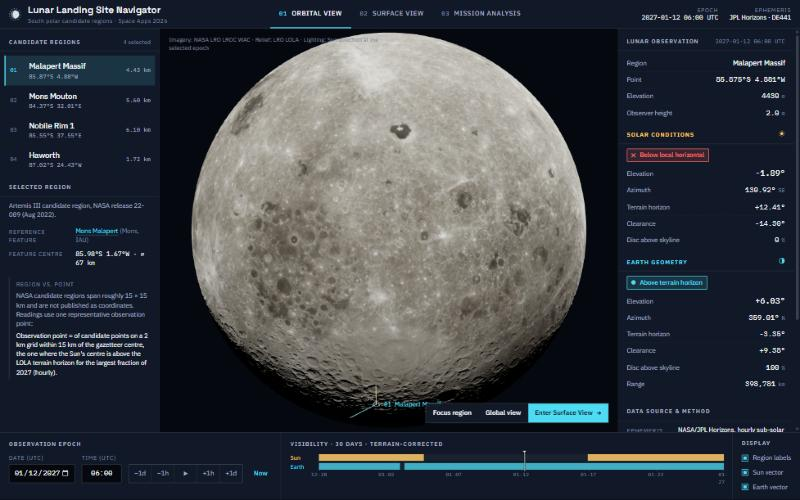

# Lunar Landing Site Navigator

An interactive tool for examining **Sun and Earth visibility at candidate landing
regions near the lunar south pole**: when a site has sunlight for power, and when
it has a direct line of sight to Earth. Built for the NASA Space Apps Challenge
2026 challenge "Lunar Landing Site Navigator".

**Live site:** https://lunar-landing-site-navigator-six.vercel.app

> Independent hackathon project. Not an official NASA product and not endorsed by
> NASA. NASA data are used under NASA's media and data usage guidelines — see
> [docs/ATTRIBUTION.md](docs/ATTRIBUTION.md).



## Features

| Mode | What it does |
|---|---|
| **01 Orbital View** | 3D Moon from LRO imagery: a 4K base map that streams 16K LROC WAC tiles as you zoom, LOLA relief (≈146 m/px around the south pole), lit by the real Sun direction at the selected time. Select one of four candidate regions, fly to it, and read Sun/Earth conditions at its observation point. |
| **02 Surface View** | Stand at the observation point: LOLA terrain (24 km at 80 m + 120 km at 400 m) with cast shadows, the terrain-corrected skyline (ray-traced to 150 km), the Sun and Earth at their computed positions, 2,847 catalogued stars, az/el grid, range rings and a 360° skyline strip. |
| **03 Mission Analysis** | Compare two site + period scenarios: % of time the Sun / Earth / both are above the terrain horizon, longest gaps, elevation ranges, visibility timelines, horizon panoramas, CSV export. |

Region, time and mode stay synchronised across views and live in the URL, e.g.
[`?mode=surface&site=haworth&t=2027-01-12T06:00Z`](https://lunar-landing-site-navigator-six.vercel.app/?mode=surface&site=haworth&t=2027-01-12T06:00Z).

### Screenshots (live deployment)

| | Desktop (1440 px) | Mobile (375 px) |
|---|---|---|
| Orbital | [01](docs/screenshots/01-orbital-view-desktop-1440.jpg) | [02](docs/screenshots/02-orbital-view-mobile-375.jpg) |
| Surface | [03](docs/screenshots/03-surface-view-desktop-1440.jpg) | [04](docs/screenshots/04-surface-view-mobile-375.jpg) |
| Mission Analysis | [05](docs/screenshots/05-mission-analysis-desktop-1440.jpg), [05b charts](docs/screenshots/05b-mission-analysis-charts-desktop-1440.jpg) | [06](docs/screenshots/06-mission-analysis-mobile-375.jpg) |

## Scientific data and method

Full methodology: [docs/SCIENCE.md](docs/SCIENCE.md). Test record: [docs/VALIDATION.md](docs/VALIDATION.md).

| Data | Source | Use |
|---|---|---|
| Sun / Earth geometry | NASA/JPL Horizons (hourly, 2026-07-01 → 2028-12-31 UTC) | Topocentric azimuth/elevation at each site; **validated** against Horizons topocentric output to ≤ 0.007° |
| Terrain | LRO LOLA `LDEM_80S_80M` (PDS Geosciences) | Horizon profiles, Surface View terrain, polar relief |
| Imagery | LRO LROC WAC mosaic via NASA SVS CGI Moon Kit (8K/16K) | Globe colour |
| Global relief | LOLA `ldem_16` via NASA SVS | Globe normal map |
| Feature names / centres | IAU Gazetteer of Planetary Nomenclature | Region anchors |
| Stars | Yale Bright Star Catalogue (BSC5, V < 5.5) + IAU 2009 Moon rotation model (validated to 0.008°) | Surface View sky |

- Visibility is **terrain-corrected**: a body counts as visible when its disc centre
  is above the LOLA skyline at that azimuth, for an observer 2 m above the surface.
- NASA has not published coordinates for its ≈15 × 15 km candidate regions. Each
  region uses one representative observation point selected by a documented,
  reproducible rule. These are **not** NASA-designated landing sites.
- Outside the precomputed ephemeris range the app shows "no data" rather than
  extrapolating. No suitability scores are computed.

## Technology

React 19 · TypeScript 5.7 · Vite 6 · three.js 0.172 · React Three Fiber 9 · drei 10 ·
GSAP 3 · zustand 5 · Python 3 (numpy, Pillow) for preprocessing. Fonts: IBM Plex Sans,
IBM Plex Mono, Space Grotesk (self-hosted via `@fontsource`).

## Install, build, run

Requirements: Node 18+ (tested with Node 26 / npm 11).

```bash
npm ci
npm run dev        # development server
npm run build      # type-check + production build → dist/
npm run preview    # serve dist/ locally
```

`dist/` is fully static (relative `base: './'`). All scientific data ships
precomputed in `public/data/`; there are no API keys and no runtime calls to
external services.

## Deployment

Production is hosted on Vercel as an independent project
(`lunar-landing-site-navigator`), configured by [`vercel.json`](vercel.json):
`npm ci` → `npm run build` → serve `dist/`, with long-lived caching for hashed
assets. Deploy with the Vercel CLI from the project root:

```bash
vercel deploy --prod
```

## Reproduce the data (optional)

Committed `public/` assets were produced by the scripts in `preprocess/`. Raw
downloads (~500 MB) go to `data_raw/`, which is git-ignored.

```bash
pip install -r preprocess/requirements.txt
python preprocess/fetch_ephemeris.py        # JPL Horizons → public/data/ephemeris.json
# download into data_raw/ (URLs in docs/ATTRIBUTION.md):
#   lroc_color_poles_8k.tif, lroc_color_poles_16k.tif, ldem_16.tif   (NASA SVS CGI Moon Kit)
#   ldem_80s_80m.img, ldem_80s_80m.lbl                                (PDS, LOLA GDR polar)
python preprocess/build_globe_textures.py   # base colour map, normal maps, 16K tiles
python preprocess/process_dem.py            # observation points, horizons, terrain tiles, polar relief (several minutes)
python preprocess/validate_ephemeris.py     # cross-check vs Horizons topocentric → validation.json
python preprocess/build_stars.py            # star catalogue + Moon rotation validation
```

## Project structure

```
src/
  data/          typed scientific interfaces, loaders, data context
  science/       frames & topocentric geometry, ephemeris, visibility metrics, Moon orientation
  state/         app store (zustand), URL sync
  three/         globe material + LOD tiles, orbital scene & camera, surface scene
  three/surface/ terrain, stars, sky grid, range rings, illustrative regolith texture
  ui/            top bar, panels, time controls, mobile sheet, compass, surface overlays
  ui/analysis/   comparison workspace, timelines, horizon panorama
  styles/        design tokens + global styles
preprocess/      reproducible Python data pipeline
public/data/     ephemeris, sites (points + horizon profiles), validation, stars, terrain tiles
public/textures/ globe base maps, 16K tiles, south-polar relief
docs/            SCIENCE.md, ATTRIBUTION.md, VALIDATION.md, screenshots/
```

## Known limitations

- Four of NASA's candidate regions, one observation point each; no free point picking.
- Ephemeris coverage fixed to 2026-07-01 – 2028-12-31 UTC.
- Visibility uses the disc centre (partial-disc fraction shown in readings only);
  geometric line of sight only — no link budgets, antennas, thermal or slope hazards.
- Measured terrain resolution is 80 m. Surface View display aids — "Enhanced
  visibility" fill light (on by default) and "Fine texture (illustrative)" — are
  not measurements; both are labelled and can be switched off.
- Earth is a shaded disc with correct phase but no surface imagery.
- The official challenge page could not be fetched from the development
  environment (TLS certificate error); requirements came from the team brief.
- Mission Voice Assistant deferred by design.

See [docs/VALIDATION.md](docs/VALIDATION.md) for test coverage and open issues.
